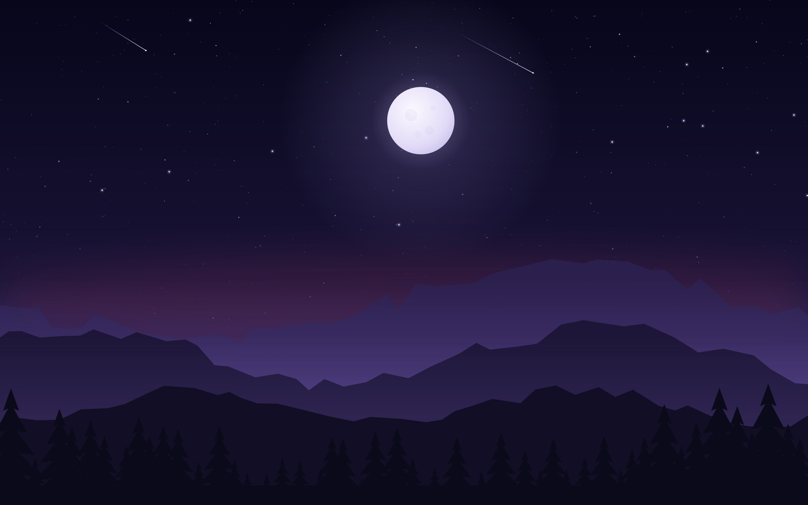
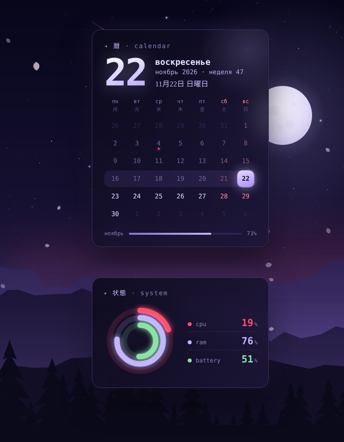
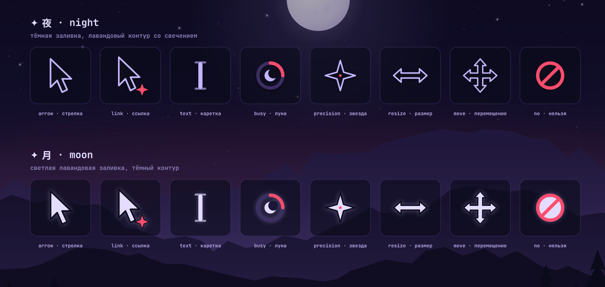

<h1 align="center">✦ 夜 · night</h1>
<p align="center">dotfiles для macOS · ночное небо, лаванда и луна · <code>夜はまだ長い</code></p>

<p align="center"></p>

### ✦ что внутри

| | |
|---|---|
| **ghostty/** | конфиг и тема `saiko-night` (фон `#0b0a1a`, лаванда `#c4b5fd`, акцент `#ff4d6d`) |
| **starship/** | powerline-промпт с палитрой от розового к лавандовому |
| **zsh/** | `.zshrc`: autosuggestions, syntax highlighting, zoxide, atuin, eza, bat |
| **ubersicht/** | виджеты стола: часы, календарь, кольца системы, терминал, звёзды и сакура |
| **wallpapers/** | обои 2880×1800 |
| **cursors/** | набор курсоров `night` для Mousecape |
| **icons/** | иконки TypeSpeed и Files |
| **macos/** | системные настройки через `defaults` |
| **themes/calm/** | вторая тема «calm»: обои, тема Ghostty, виджеты |
| **bin/theme** | переключатель тем `theme night \| calm \| toggle \| status` |
| **ios/** | `night.js` - виджеты Scriptable для айфона (reminders, calendar, status, terminal) |

<p align="center"> </p>

### ✦ темы

Две темы: **night** (по умолчанию, ночное небо и лаванда) и **calm** (чернильный фон, один тёплый янтарный акцент `#e8b76a`, виджеты без карточек).

```bash
theme night | calm | toggle | status
```

Переключатель меняет обои, набор виджетов Übersicht (трогает только файлы с `// saiko` в первой строке), тему Ghostty, цвета Starship, зазоры AeroSpace (14px в calm) и системный акцент. Курсор и иконки в него не входят. Состояние хранится в `~/.config/theme`. Для обоев может понадобиться System Settings → Privacy & Security → Automation → System Events.

### ✦ установка

```bash
git clone https://github.com/saikoxdd/dotfiles ~/dotfiles
cd ~/dotfiles && bash install.sh
```

Конфиги ставятся симлинками, так что правки в `~/.config` сразу попадают в репо. Старые файлы сохраняются рядом как `*.bak.<время>`.

### ✦ руками

- **курсор**: [Mousecape (Tahoe fork)](https://github.com/AdamWawrzynkowskiGF/Mousecape-TahoeSupport/releases) → File → Import Cape → `cursors/night-68.cape` → Apply → Install Helper Tool
- **автозапуск**: System Settings → General → Login Items → Übersicht, AltTab, Raycast, Shottr
- **иконки**: System Settings → Appearance → Icon & widget style
- **Ghostty в App Management** нужен только для смены иконок через `fileicon`

### ✦ обновить репо

```bash
bash collect.sh && git add -A && git commit -m "update" && git push
```

`collect.sh` сам переключается на night на время сбора (и возвращает тему обратно), копирует `ios/night.js` из iCloud Scriptable и актуальные конфиги с мака, делает `Brewfile` и проверяет файлы на токены и пароли.
